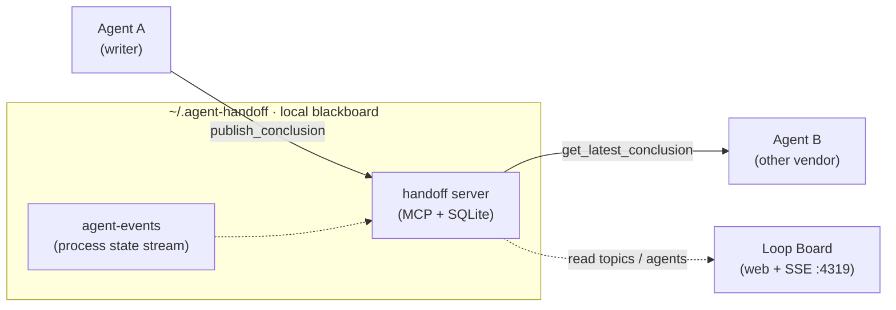

# agent-handoff

**English** | [简体中文](README.zh-CN.md)

Local-first cross-agent handoff infrastructure: let one AI agent publish a
structured conclusion, and a different vendor's agent pick it up and review it
independently — without copy-paste.

## Why

Switching agents today means leaving the context behind:

- **Copy-paste handoffs**: moving work from Claude to Codex / Cursor / Gemini
  means pasting chat logs that truncate, drift, and age badly.
- **No authoritative state**: with parallel sessions there is no single
  "current conclusion" — stale decisions keep resurfacing and get re-litigated.
- **Anchored reviews**: an agent that can see the original implementation tends
  to approve it; independent review needs a hidden baseline.
- **Invisible process**: claim / progress / block state lives in terminal
  scrollback, invisible to other agents and to you.

agent-handoff answers with a local blackboard: latest-wins conclusions with
supersede chains, an anti-anchoring review protocol, and a live process board.
It is deliberately **not** a general-purpose long-term memory — no semantic
recall, no embeddings. It stores decisions and handoffs, not knowledge; if you
need recall over notes, pair it with a memory tool.



Handoff records are context only. `next_action` is always a suggestion, never
authorization to commit, push, or call remote APIs — your normal workflow gates
still apply.

## Packages

| Package | What it is |
|---|---|
| `server/` | MCP server (TypeScript): conclusions, logical topics, hidden-baseline independent review cases, secret scanning, idempotent writes, supersede chains |
| `board/` | Local web board (React + Node): topic/agent states, SSE live updates, ops actions, optional Electron tray app |
| `agent-events/` | Tiny SQLite event stream for process state (claim / progress / block / release / heartbeat) |
| `trace-store/` | Local SQLite trace store with metrics CLI and dashboard |
| `shared/` | Canonical topic / workspace normalization used by both server and board |
| `skills/` | Installable cross-agent review handoff skill (canonical Claude format; adapt per platform) |
| `docs/` | Protocol and usage docs — start with `docs/independent-review-protocol.md` |

## Highlights

- **Hidden-baseline independent review**: the author agent publishes its work
  and a review case that withholds the baseline; the reviewer agent assesses
  the referenced code from the packet alone, submits the assessment, and only
  then is the baseline revealed — an anti-anchoring A/B protocol.
- **Cross-vendor by design**: records carry `source_agent` / `model` platform
  IDs; one Claude session can hand off to Codex, Cursor, Copilot, Gemini, …
- **Topic lifecycle**: every logical topic carries an explicit task state
  (`open` / `done` / `cancelled`) with a full audit trail; publishing a new
  handoff to a done or cancelled topic auto-reopens it, so task state never
  silently drifts.
- **Local-first storage**: everything lives under `~/.agent-handoff/`
  (SQLite + JSON fallback files). No cloud, no network calls.
- **Safety defaults**: secret scanning on writes, sensitivity levels,
  idempotency `request_id` for mutating tools, tool-call residue rejection.

## Quick start

Requirements: Node.js ≥ 22.5 (`node:sqlite`).

```bash
# 1. MCP server
cd server
npm install && npm run build
./install.sh --platforms claude-code,codex,cursor   # or --all

# 2. Board (optional but recommended)
cd ../board
npm install
npm run build
npm start            # http://127.0.0.1:4319

# 3. Publish an agent event (optional)
cd ../agent-events
node src/cli.mjs publish --project my-repo --workspace /abs/path/to/my-repo \
  --topic ISSUE-123 --agent codex --event-type task_progress \
  --payload '{"note":"investigating"}'
```

## Configuration

| Env var | Purpose |
|---|---|
| `AGENT_HANDOFF_HOME` | Storage root, default `~/.agent-handoff` |
| `AGENT_HANDOFF_SECRET_SCAN` | Set `1`/`0` (default on) |
| `AGENT_HANDOFF_TZ` | Display timezone for human-readable timestamps |
| `AGENT_HANDOFF_CANONICAL_WORKSPACES` | JSON map of project → canonical checkout path, e.g. `{"my-repo":"/abs/path"}` |
| `HANDOFF_BOARD_PORT` | Board port, default `4319` |
| `WORKFLOW_TRACES_DB_PATH` | Override trace db location |

## Docs

- [Independent review protocol](docs/independent-review-protocol.md) — the A/B evidence and sequencing rules
- [Cross-agent review handoff](docs/cross-agent-review-handoff.md) — conventions, templates, rationale · [简体中文](docs/cross-agent-review-handoff.zh-CN.md)
- [Loop Engineering Board](docs/handoff-board.md) — board phases and event model
- [Board React/Vite migration](docs/handoff-board-react-vite-migration.md) — design record for the board rewrite

## License

[MIT](LICENSE)
