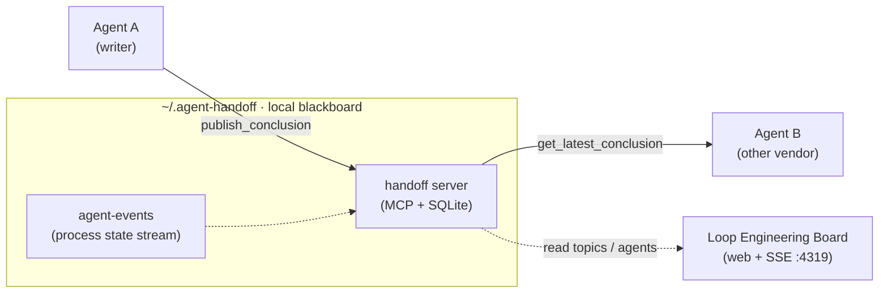
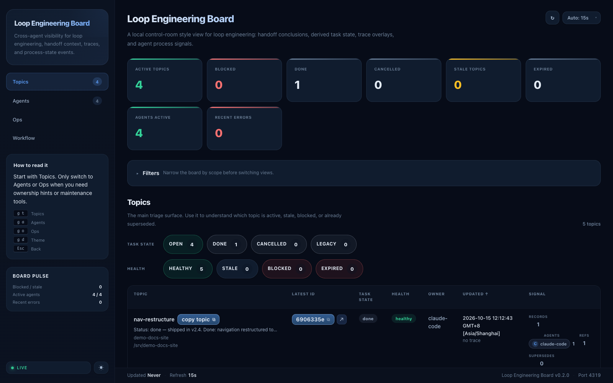
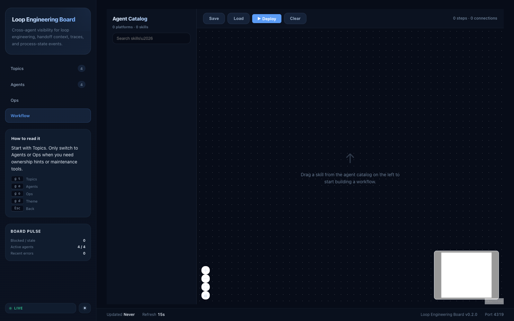

# agent-handoff

**English** | [简体中文](README.zh-CN.md)

Local-first cross-agent handoff infrastructure: let one AI agent publish a
structured conclusion, and a different vendor's agent pick it up and review it
independently — without copy-paste.

## Why

Switching agents today means leaving the context behind:

- **Copy-paste handoffs**: moving work from Claude to Codex / Cursor / Gemini
  means pasting chat logs that truncate, drift, and age badly.
- **No authoritative state**: with parallel sessions there is no single
  "current conclusion" — stale decisions keep resurfacing and get re-litigated.
- **Anchored reviews**: an agent that can see the original implementation tends
  to approve it; independent review needs a hidden baseline.
- **Invisible process**: claim / progress / block state lives in terminal
  scrollback, invisible to other agents and to you.

agent-handoff answers with a local blackboard: latest-wins conclusions with
supersede chains, an anti-anchoring review protocol, and a live process board —
the **Loop Engineering Board**. The name is literal: the board watches one loop
end to end — a problem is posed, an agent solves it, a different agent
independently reviews it, the conclusion persists, and any backlog re-enters
the loop until nothing remains.
It is deliberately **not** a general-purpose long-term memory — no semantic
recall, no embeddings. It stores decisions and handoffs, not knowledge; if you
need recall over notes, pair it with a memory tool.



Handoff records are context only. `next_action` is always a suggestion, never
authorization to commit, push, or call remote APIs — your normal workflow gates
still apply.

## Packages

| Package | What it is |
|---|---|
| `server/` | MCP server (TypeScript): conclusions, logical topics, hidden-baseline independent review cases, secret scanning, idempotent writes, supersede chains |
| `board/` | Local web board (React + Node): topic/agent states, SSE live updates, guided workflow designer (human-gated, no auto-execution), ops actions, optional Electron tray app |
| `agent-events/` | Tiny SQLite event stream for process state (claim / progress / block / release / heartbeat) |
| `trace-store/` | Local SQLite trace store with metrics CLI and dashboard |
| `shared/` | Canonical topic / workspace normalization used by both server and board |
| `skills/` | Installable cross-agent review handoff skill (canonical Claude format; adapt per platform) |
| `docs/` | Protocol and usage docs — start with `docs/independent-review-protocol.md` |

## The loop, and loop engineering

**Loop engineering** — a practice named in the AI industry in mid-2026 —
designs systems where agents iterate on their own: *execute → verify →
persist → re-enter*, until nothing remains. Its credo: the quality of a loop
is the quality of its verifiable signals.

agent-handoff is that idea in a **human-relayed** form: no orchestrator
dispatches agents — you decide when work crosses a vendor boundary via one
copy-ready prompt block. The infrastructure concentrates on the two hard
parts of any loop:

- **verifiable signal** — hidden-baseline independent review: the reviewer
  assesses from a packet that withholds the baseline, so approval cannot be
  anchored to the author's reasoning
- **persistence** — latest-wins conclusions with supersede chains: every new
  round starts from the authoritative record, never from chat scrollback

| Loop stage | Capability |
|---|---|
| pose | `resolve_topic` · explicit task state (`open` / `done` / `cancelled`), auto-reopen on new publish |
| solve | `publish_conclusion` · secret scanning · idempotent `request_id` |
| review | `create_review_case` → `submit_independent_assessment` → `publish_review_comparison` (baseline revealed only after assessment) |
| persist | latest-wins + supersede chains · canonical topics across projects/workspaces |
| re-enter | ≤12-line copy-ready prompt block for the next vendor's agent |

Watch the loop live on the board — topics with task states and supersede
signal on the left, the cross-model workflow on the right (screenshots use
isolated demo data):




## Highlights

- **Hidden-baseline independent review**: the author agent publishes its work
  and a review case that withholds the baseline; the reviewer agent assesses
  the referenced code from the packet alone, submits the assessment, and only
  then is the baseline revealed — an anti-anchoring A/B protocol.
- **Prompt-driven, not command-driven**: install the `skills/` package once;
  from then on any cross-agent intent triggers it — "have Codex independently
  review this", "run a cross-model review", "review the latest handoff". The
  agent does all MCP calls and, whenever follow-ups remain, hands you a
  copy-ready ≤12-line prompt block for the next vendor's agent — the record
  is the payload, the prompt is the pointer.
- **Cross-vendor by design**: records carry `source_agent` / `model` platform
  IDs; one Claude session can hand off to Codex, Cursor, Copilot, Gemini, …
- **Topic lifecycle**: every logical topic carries an explicit task state
  (`open` / `done` / `cancelled`) with a full audit trail; publishing a new
  handoff to a done or cancelled topic auto-reopens it, so task state never
  silently drifts.
- **Local-first storage**: everything lives under `~/.agent-handoff/`
  (SQLite + JSON fallback files). No cloud, no network calls.
- **Safety defaults**: secret scanning on writes, sensitivity levels,
  idempotency `request_id` for mutating tools, tool-call residue rejection.

## Quick start

Requirements: Node.js ≥ 22.5 (`node:sqlite`).

```bash
# 1. MCP server
cd server
npm install && npm run build
./install.sh --platforms claude-code,codex,cursor   # or --all

# 2. Board (optional but recommended)
cd ../board
npm install
npm run build
npm start            # http://127.0.0.1:4319

# 3. Publish an agent event (optional plumbing; daily use is prompt-driven — see below)
cd ../agent-events
node src/cli.mjs publish --project my-repo --workspace /abs/path/to/my-repo \
  --topic ISSUE-123 --agent codex --event-type task_progress \
  --payload '{"note":"investigating"}'
```

## Daily usage: prompts, not commands

The Quick start commands are plumbing — after install you never type them.
Day to day you talk to the agent, and the [`skills/`](skills/) package turns
that into a closed loop:

**1 · Finish work in one agent**, then express cross-agent intent — any
wording works:

> Have Codex independently review this parser fix.

No magic keyword: cross-agent review, independent review, or "continue the
previous handoff" all trigger the skill. Publishing stays opt-in, though —
an agent that merely reached a result never publishes behind your back.
Once triggered, the agent publishes the structured conclusion (plus a
hidden-baseline review case) through MCP tools, then — depending on what
the work leaves behind — automatically emits a copy-ready **next-step
prompt block**: at most 12 lines of ids and an action sequence, never a
restated report. With zero follow-ups it emits no block, just a one-line
note.

```text
[agent-handoff] project=my-repo
workspace=/abs/path/to/my-repo
logical_topic_id=<uuid>
supersedes_id=<comparison-conclusion-id>
Actions: get_topic_context <uuid> -> address reviewer_only backlog in the latest comparison
Scope guard: docs/ and skills/ only; no backend code
```

**2 · Open a different vendor's agent** (Codex / Cursor / Gemini), paste the
block — or just say "review the latest handoff" / "接上次结论审一遍". It pulls
the record, reviews it with its own independent judgment, and publishes the
comparison; the thread automatically continues on the same logical topic.

**3 · Watch it live** on the Board (http://127.0.0.1:4319): topic states,
agent claims, review cases, supersede chains.

The record is the payload; the prompt is the pointer. That one block is all
that ever crosses a vendor boundary — no chat-log pasting, no truncation.
The `agent-events` CLI from Quick start works the same way: say "report
progress" / "claim this topic" and your agent invokes it for you.

## Configuration

| Env var | Purpose |
|---|---|
| `AGENT_HANDOFF_HOME` | Storage root, default `~/.agent-handoff` |
| `AGENT_HANDOFF_SECRET_SCAN` | Set `1`/`0` (default on) |
| `AGENT_HANDOFF_TZ` | Display timezone for human-readable timestamps |
| `AGENT_HANDOFF_CANONICAL_WORKSPACES` | JSON map of project → canonical checkout path, e.g. `{"my-repo":"/abs/path"}` |
| `HANDOFF_BOARD_PORT` | Board port, default `4319` |
| `WORKFLOW_TRACES_DB_PATH` | Override trace db location |

## Docs

- [Independent review protocol](docs/independent-review-protocol.md) — the A/B evidence and sequencing rules
- [Cross-agent review handoff](docs/cross-agent-review-handoff.md) — conventions, templates, rationale · [简体中文](docs/cross-agent-review-handoff.zh-CN.md)
- [Loop Engineering Board](docs/handoff-board.md) — board phases and event model
- [Board React/Vite migration](docs/handoff-board-react-vite-migration.md) — design record for the board rewrite

## License

[MIT](LICENSE)
