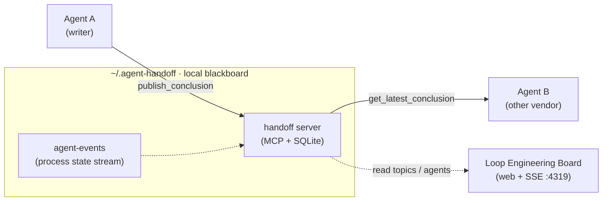

# agent-handoff

> [English](README.md) | 简体中文

本地优先的跨 Agent 交接基础设施：让一个 AI agent 发布结构化结论，由另一厂商的 agent 接手并独立 review——无需 copy-paste。

## 为什么需要

换 agent 就等于丢上下文：

- **copy-paste 交接**：把工作从 Claude 移到 Codex / Cursor / Gemini，只能粘贴聊天记录——会截断、会漂移、很快过期。
- **没有权威状态**：多个会话并行时不存在唯一的"当前结论"——过期决策反复冒头、被反复重新讨论。
- **评审被锚定**：能看见原实现的 agent 倾向于认可原实现；独立评审需要隐藏 baseline。
- **过程不可见**：claim / progress / block 状态埋在终端滚动区里，其他 agent 和你都看不见。

agent-handoff 用一块本地黑板来回应：latest-wins 结论 + supersede 链、防锚定评审协议、实时过程面板——即 **Loop Engineering Board**。这个名字是字面意义的：面板端到端观测一个回环——问题抛出、agent 解答、另一厂商 agent 独立评审、结论沉淀、有遗留则重新入环，直到归零。
它**刻意不是**通用长期记忆系统——没有语义召回、没有 embedding。它存的是决策与交接，不是知识；需要按语义检索笔记时，请搭配记忆类工具使用。



交接记录只是上下文。`next_action` 始终是建议，绝不构成提交、推送或调用远端 API 的授权——你原有的人工流程闸门仍然生效。

## 包结构

| 包 | 说明 |
|---|---|
| `server/` | MCP server（TypeScript）：结论、逻辑 topic、隐藏 baseline 的独立评审 case、密钥扫描、幂等写入、supersede 链 |
| `board/` | 本地 Web 面板（React + Node）：topic/agent 状态、SSE 实时更新、运维操作、可选 Electron 托盘应用 |
| `agent-events/` | 轻量 SQLite 事件流，记录进程状态（claim / progress / block / release / heartbeat） |
| `trace-store/` | 本地 SQLite trace 存储，带指标 CLI 与仪表盘 |
| `shared/` | server 与 board 共用的 topic / workspace 归一化逻辑 |
| `skills/` | 可安装的跨 agent review 交接 skill（Claude 格式规范版；各平台按需适配） |
| `docs/` | 协议与使用文档——从 `docs/independent-review-protocol.md` 开始 |

## 亮点

- **隐藏 baseline 的独立评审**：写方 agent 发布工作成果和一个隐藏 baseline 的评审 case；审方 agent 只凭 packet 评估被引用的代码，  提交 assessment 之后才揭示 baseline——一套防锚定的 A/B 协议。
- **提示词驱动，而非命令驱动**：装一次 `skills/` 包，之后任何跨 agent 意图都能触发——"让 Codex 独立审一下"、"跑个跨模型 review"、"接上次结论审一遍"。MCP 调用全部由 agent 完成，且只要还有后续事项，就会自动交给你一个可直接复制的 ≤12 行提示词块，转交给下一厂商的 agent——记录是载荷，提示词只是指针。
- **天然跨厂商**：记录携带 `source_agent` / `model` 平台 ID；一个 Claude 会话可以交接给 Codex、Cursor、Copilot、Gemini…
- **Topic 生命周期**：每个逻辑 topic 都带显式任务状态（`open` / `done` / `cancelled`）与完整审计轨迹；向已完成或已取消的 topic 发布新交接会自动重开，任务状态不会悄悄漂移。
- **本地优先存储**：一切都在 `~/.agent-handoff/` 下（SQLite + JSON 兜底文件）。无云端、无网络调用。
- **安全默认**：写入时密钥扫描、敏感级别、变更类工具的幂等 `request_id`、工具调用残留拒绝。

## 快速开始

要求：Node.js ≥ 22.5（`node:sqlite`）。

```bash
# 1. MCP server
cd server
npm install && npm run build
./install.sh --platforms claude-code,codex,cursor   # 或 --all

# 2. Board（可选但推荐）
cd ../board
npm install
npm run build
npm start            # http://127.0.0.1:4319

# 3. 发布一条 agent event（可选管道；日常使用是提示词驱动——见下节）
cd ../agent-events
node src/cli.mjs publish --project my-repo --workspace /abs/path/to/my-repo \
  --topic ISSUE-123 --agent codex --event-type task_progress \
  --payload '{"note":"investigating"}'
```

## 日常使用：提示词，而非命令

快速开始里的命令只是底层管道——装好之后你不再敲命令。日常你直接对 agent 说话，[`skills/`](skills/) 包会把它闭成环：

**1 · 在一个 agent 里完成工作**，然后表达跨 agent 意图——怎么说都行：

> 让 Codex 独立审一下这个解析器修复。

没有魔法关键词：跨 agent 评审、独立评审、"继续上次的 handoff"都能触发。但发布保持 opt-in——仅仅做出了成果的 agent 绝不会背着你发布。触发后，agent 通过 MCP 工具发布结构化结论（以及隐藏 baseline 的评审 case），并**根据场景自动**产出可直接复制的**下一步提示词块**：至多 12 行，只含 id 与动作序列——绝不复述报告本身；若没有任何后续事项，则不出块，只以一行说明。

```text
[agent-handoff] project=my-repo
workspace=/abs/path/to/my-repo
logical_topic_id=<uuid>
supersedes_id=<comparison-conclusion-id>
Actions: get_topic_context <uuid> -> address reviewer_only backlog in the latest comparison
Scope guard: docs/ and skills/ only; no backend code
```

**2 · 打开另一厂商的 agent**（Codex / Cursor / Gemini），粘贴该块——或直接说"接上次结论审一遍" / "review the latest handoff"。它会拉取记录、以自身独立判断完成评审并发布对比；线程自动续在同一逻辑 topic 上。

**3 · 在 Board 上实时观看**（http://127.0.0.1:4319）：topic 状态、agent 认领、评审 case、supersede 链。

记录是载荷，提示词只是指针。跨厂商边界流转的只有这一个块——不搬运聊天记录，不会截断。快速开始第 3 步的 agent-events CLI 同理：说一句"汇报进度" / "claim 这个 topic"，agent 会替你调用。

## 配置

| 环境变量 | 用途 |
|---|---|
| `AGENT_HANDOFF_HOME` | 存储根目录，默认 `~/.agent-handoff` |
| `AGENT_HANDOFF_SECRET_SCAN` | 设 `1`/`0`（默认开） |
| `AGENT_HANDOFF_TZ` | 人类可读时间戳的显示时区 |
| `AGENT_HANDOFF_CANONICAL_WORKSPACES` | project → 规范 checkout 路径的 JSON 映射，如 `{"my-repo":"/abs/path"}` |
| `HANDOFF_BOARD_PORT` | Board 端口，默认 `4319` |
| `WORKFLOW_TRACES_DB_PATH` | 覆盖 trace 数据库位置 |

## 文档

- [独立评审协议](docs/independent-review-protocol.md)（英文）— A/B 证据与时序规则
- [跨 Agent review 交接约定](docs/cross-agent-review-handoff.zh-CN.md)（中文）/ [English](docs/cross-agent-review-handoff.md) — 约定、模板、设计理由
- [Loop Engineering Board](docs/handoff-board.md)（英文）— board 阶段与事件模型
- [Board React/Vite 迁移记录](docs/handoff-board-react-vite-migration.md)（英文）— board 重写的设计记录

## 许可证

[MIT](LICENSE)
