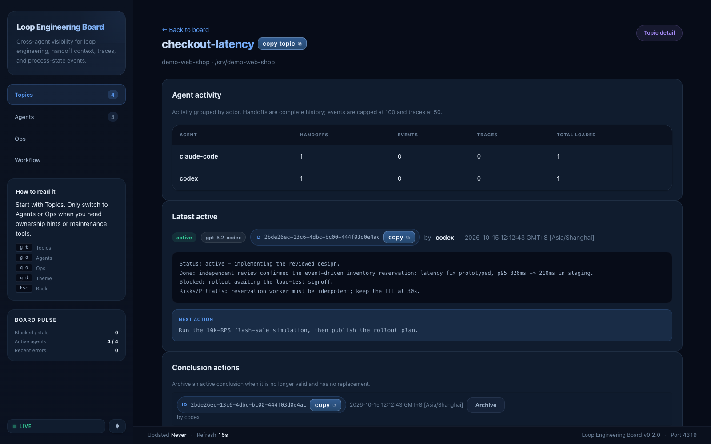
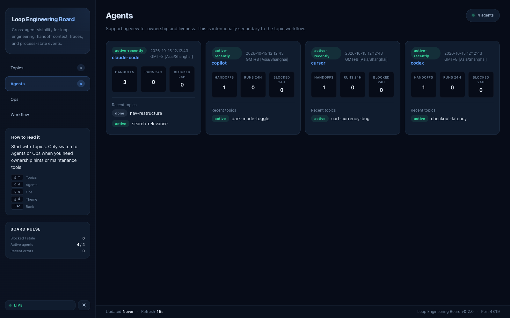

# Loop Engineering Board

Local web board for loop engineering with `agent-handoff` conclusions, trace overlay, and agent events.

The loop it watches: a problem is posed → an agent solves it → a different
agent independently reviews it → the conclusion persists → any backlog
re-enters the loop until nothing remains.

## What it shows

- grouped topics by `project + workspace + topic`
- latest active handoff, history, and supersede signal
- derived task states like `active`, `stale`, `blocked-suspect`, `expired`
- derived agent states using handoff publish history and local trace activity
- separate `agent_events` protocol for claim/progress/block/release/heartbeat
- local ops for health, backup, and cleanup preview

Screenshots (isolated demo data):






## Run

> **Port guide for agents**
>
> | Scenario | Command | Browser URL | Notes |
> |---|---|---|---|
> | **Normal use** (agents, daily work) | `npm run build && npm start` | **`http://127.0.0.1:4319`** | Single server serves everything: API + SSE + static SPA. **This is the default — always use 4319.** |
> | **Frontend dev only** (HMR, CSS tweaking) | Two terminals: `npm start` + `npm run dev` | `http://localhost:5173` | Vite dev server on 5173 proxies `/api`, `/events`, `/ops` to 4319. Only needed during active React/CSS development. |
>
> **Do NOT open port 5173 for normal tasks.** Port 5173 requires a separate Vite dev server and will show a blank page or connection errors if only `npm start` is running.

### Production (built React SPA) — the default

```bash
cd board
npm run build   # build React app to dist/
npm start       # serve API + static SPA on port 4319
```

Then open `http://127.0.0.1:4319`.

The `server.mjs` on port 4319 is a full-featured standalone server: it serves the built React app from `dist/` AND handles all `/api/*`, `/events` (SSE), and `/ops/*` routes. No Vite, no proxy, no second process needed.

### Development (Vite HMR + API proxy) — only for frontend development

```bash
# Terminal 1: backend API server (must be running first)
cd board
npm start

# Terminal 2: Vite dev server with HMR (optional, only for frontend dev)
cd board
npm run dev
```

Open `http://localhost:5173` — Vite proxies `/api`, `/events`, `/ops` to the backend on 4319.

This mode is **only** useful when you are actively editing React components and want hot module replacement. For all other tasks (checking board state, verifying data, demos), use the production mode above.

## Defaults

- handoff DB: `~/.agent-handoff/handoff.db`
- handoff files: `~/.agent-handoff/files`
- trace DB: `.agent-handoff/traces.db`

Optional environment variables:

```bash
export HANDOFF_BOARD_HOST=127.0.0.1
export HANDOFF_BOARD_PORT=4319
export AGENT_HANDOFF_HOME="$HOME/.agent-handoff"
export AGENT_HANDOFF_DB_PATH="$HOME/.agent-handoff/handoff.db"
```

The board is local-only and does not try to control agents or bypass existing workflow gates.

## Electron Desktop App

The optional Electron app is a cross-platform tray controller for this Board
service. It does not start or configure `llm-router-gateway`.

```bash
npm run electron:build
```

For a local packaged build:

```bash
npm run electron:pack
```

The app manages the Board as an independent service:

- macOS: `launchd`
- Windows: Scheduled Task
- Linux: `systemd --user`

The tray menu (items track live service status):

| Group | Items |
|---|---|
| status | `Loop Engineering Board · <status>` · `App <version> · Board <version>` |
| open | Open Board · Open in Browser |
| service | Start · Stop · Restart |
| autostart | Start Board at Login · Start App at Login (checkboxes) |
| ops | Open Logs · Check for Updates / Download Update / Install Update |
| quit | Quit |

The Board service uses the existing `~/.agent-handoff` data directory and the
app never replaces it during updates.

The packaged app requires Node.js `>=22.5` because the Board server uses
`node:sqlite`. Set `SYSTEM_NODE` when Node is installed outside the standard
platform locations. For generic-provider updates, set
`HANDOFF_BOARD_UPDATE_URL` to the directory containing the updater metadata
before launching the packaged app.

## Publish agent events

The board now uses a separate local SQLite event stream instead of overloading handoff conclusions for process state.

CLI example:

```bash
node ../agent-events/src/cli.mjs publish \
  --project my-repo \
  --workspace /absolute/workspace \
  --topic ISSUE-25481 \
  --agent codex \
  --event-type task_progress \
  --payload '{"note":"Investigating review gaps"}'
```

Supported event types:

- `task_claimed`
- `task_progress`
- `task_blocked`
- `task_released`
- `agent_heartbeat`
